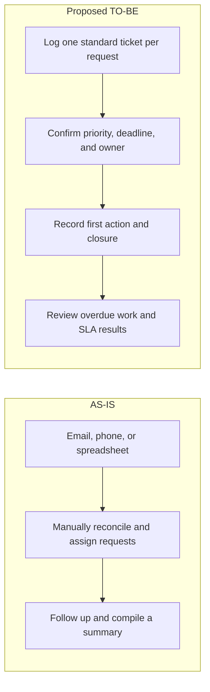
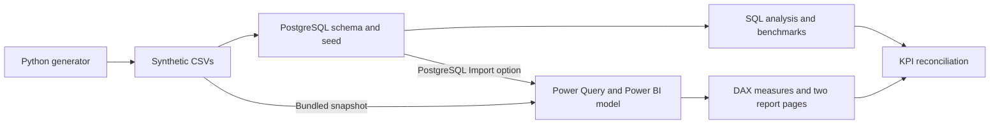
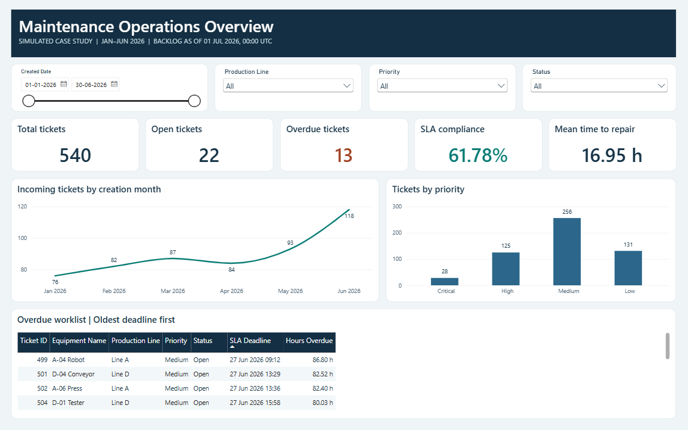
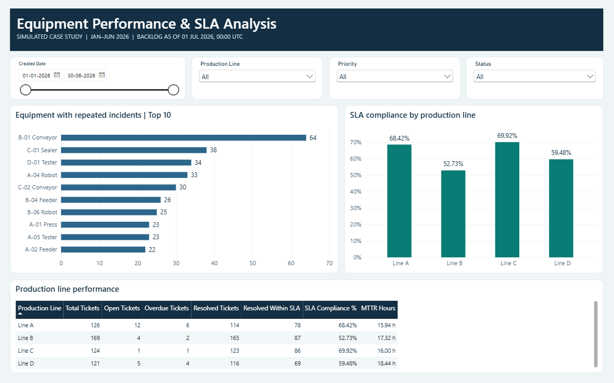

# Smart Maintenance Operations & SLA Management

**Simulated Business Analyst portfolio case study.** All records are synthetic, and the manufacturer and stakeholder roles are fictional.

Maintenance requests arrive through spreadsheets, email, and phone calls. Supervisors have to reconcile those channels to identify ticket owners, urgency, and unresolved work. The project models a centralized ticket dataset and uses **Microsoft Power BI Desktop** to help managers prioritize overdue work, compare SLA performance, and identify equipment for investigation.

Open the verified [Power BI report](powerbi/maintenance_dashboard.pbix) to explore the bundled synthetic data in Power BI Desktop. Use the [portfolio walkthrough](docs/portfolio_walkthrough.md) to present the case to a reviewer or interviewer.

## Business analysis

As the Business Analyst, I translated the scenario into stakeholder needs, requirements, process maps, KPI definitions, and acceptance tests. The hypothetical maintenance manager owns prioritization and escalation. Production supervisors need a line-level view of the backlog, technicians need clear assignment and timestamp rules, and the operations director needs a consistent basis for comparing lines.

| Portfolio artifact | Contents |
| --- | --- |
| [Business Requirements Document](docs/business_requirements.md) | Objectives, stakeholder analysis, scope, requirements, and measurable success criteria. |
| [Process flows](docs/process_flows.md) | AS-IS workflow and the proposed TO-BE process with ownership and escalation. |
| [Business rules](docs/business_rules.md) | Priority thresholds, SLA cutoff rules, ticket lifecycle, and reporting assumptions. |
| [User stories](docs/user_stories.md) and [UAT scenarios](docs/uat_test_cases.md) | Eight stories with acceptance criteria and eleven test scenarios with verification status. |
| [Portfolio walkthrough](docs/portfolio_walkthrough.md) | A 60-second explanation, demo sequence, and answers to likely reviewer questions. |

### AS-IS and proposed TO-BE



## Data and solution architecture

The dataset has 540 maintenance tickets created from January through June 2026, with 24 assets, 12 technicians, and four production lines. Each ticket has one asset and may have a technician assignment. July 1, 2026, 00:00 UTC is the fixed reporting snapshot. [Data dictionary](docs/data_dictionary.md)



## Repository layout

| Path | Purpose |
| --- | --- |
| `data/` | Generated CSVs for equipment, technicians, and tickets. |
| `scripts/` | Reproducible Python data generator. |
| `sql/` | Schema, seed load, data checks, KPI benchmarks, and business findings queries. |
| `tests/` | Data and SQL benchmark checks runnable with the Python standard library. |
| `docs/` | Requirements, process maps, user stories, business rules, UAT, data dictionary, KPIs, and recommendations. |
| `powerbi/` | Verified PBIX, editable PBIP project, build guide, Power Query, DAX, and screenshots. |

## Load the PostgreSQL demo database

Use PostgreSQL 16 or newer with `psql` and Python 3.11 or newer for regeneration and tests. Run the commands below from the repository root. On Windows, if `psql` is unavailable by name, invoke the executable from the PostgreSQL installation's `bin` folder. Use the connection values from your own installation and enter your password at the prompt. [.env.example](.env.example) documents the connection fields. [PostgreSQL `psql` reference](https://www.postgresql.org/docs/current/app-psql.html)

```powershell
# Optional. The generated CSVs are already in data/.
python scripts/generate_data.py
python -m unittest discover -s tests -v

psql -X -h localhost -U postgres -d postgres -c "CREATE DATABASE smart_maintenance_demo;"
psql -X -h localhost -U postgres -d smart_maintenance_demo -v ON_ERROR_STOP=1 -f sql/01_schema.sql
psql -X -h localhost -U postgres -d smart_maintenance_demo -f sql/02_seed.sql
```

Create the database once. Use a dedicated demo database because the seed replaces rows in the three demo tables on each run. It loads and validates the CSVs in one transaction. A successful load reports 10 `Open`, 12 `In Progress`, and 518 `Resolved` tickets. The [SQL checks](sql/03_validate_data.sql) also exercise foreign keys, timestamp order, lifecycle rules, and SLA cutoff behavior.

The schema, seed script, and checks passed end to end with `psql` against PostgreSQL 18.6.

## KPIs and SQL analysis

All results describe the simulated data. Ticket dates span January through June 2026, with the backlog evaluated at July 1, 2026, 00:00 UTC.

| Dashboard measure | Formula | All tickets |
| --- | --- | ---: |
| Total tickets | Count ticket IDs. | 540 |
| Open tickets | Count tickets with status `Open` or `In Progress`. | 22 |
| Overdue tickets | Count open tickets with a deadline before the snapshot. | 13 |
| SLA compliance % | Resolved on or before deadline ÷ resolved × 100. | 61.78% |
| MTTR | Average hours from first technician response to closure among resolved tickets. | 16.95 h |

The SLA deadline equals creation time plus the priority's target hours. Supporting metrics include request-to-resolution time, status and priority breakdowns, monthly volume, tickets per line, and incidents per asset. [Data dictionary](docs/data_dictionary.md) · [KPI definitions and Power BI benchmarks](docs/kpi_definitions.md)

Run the analysis and verify the benchmark export after loading the database. If you loaded Phase 1 previously, rerun `01_schema.sql` to add the SQL reporting view.

```powershell
psql -X -h localhost -U postgres -d smart_maintenance_demo -v ON_ERROR_STOP=1 -f sql/04_kpi_analysis.sql

$benchmarkCsv = Join-Path ([System.IO.Path]::GetTempPath()) 'smart_maintenance_kpi_benchmarks.csv'
psql -X -h localhost -U postgres -d smart_maintenance_demo -v ON_ERROR_STOP=1 --csv -f sql/05_kpi_benchmarks.sql -o $benchmarkCsv
python tests/verify_kpi_benchmarks.py $benchmarkCsv
```

## Power BI Desktop report

Open [maintenance_dashboard.pbix](powerbi/maintenance_dashboard.pbix) in Power BI Desktop. The verified file opens on the Operations Overview with the bundled snapshot already loaded. To edit the report definition, use the [PBIP project](powerbi/maintenance_dashboard.pbip). To refresh the report from the seeded database in Import mode, follow the [build guide](powerbi/README.md).

Both pages share date, production line, priority, and status slicers. The [DAX benchmark query](powerbi/validate_kpis.dax) matched all six SQL scenarios in Desktop, including the filtered selections without resolved tickets. The top-ten equipment ranking and 13-ticket overdue worklist also matched the SQL results.

### Maintenance Operations Overview

Tracks incoming work, SLA outcomes, and the unresolved tickets that need attention.



### Equipment Performance & SLA Analysis

Ranks repeat equipment incidents and compares SLA performance and backlog across four production lines.



Screenshots show the saved PBIX in Power BI Desktop with the bundled synthetic snapshot and all slicers cleared.

## Findings and proposed actions

| Simulated finding | Proposed action |
| --- | --- |
| 13 of 22 unresolved tickets were overdue. Both Critical overdue tickets were on Line A. | Review backlog at shift start. Confirm ownership and handle Critical cases before reviewing the rest by deadline age. |
| Line B had 52.73% SLA compliance. In 24 of 78 late closures, the first technician action came after the SLA deadline. | Pilot a dispatch owner and review unassigned or untouched work before its deadline. Measure first-action delays by priority. |
| B-01 Conveyor had 64 tickets, including 38 categorized as Mechanical. | Review mechanical work orders and inspection history. Track repeat mechanical tickets per operating hour if a corrective action is piloted. |
| June received 118 tickets, 39.81% above the January–May monthly average. | Compare weekly intake with the production plan and technician coverage before adjusting staffing. |

The proposed benefits are hypothetical. The [full findings](docs/business_findings.md) identify how to measure each pilot and link to the [reproducible SQL](sql/06_business_findings.sql).

## Verification, limitations, and next steps

- The saved PBIX reopened in Power BI Desktop and rendered both pages. The five DAX measures matched all six PostgreSQL benchmark scenarios. The equipment ranking, overdue worklist, and exact SLA deadline cases also matched SQL. [UAT scenarios](docs/uat_test_cases.md)
- The manual slicer check confirmed that Line B and High carried across pages and that clearing the selections restored the 540-ticket baseline. An authenticated PostgreSQL Import refresh in a separate Desktop copy also passed all six SQL-to-DAX benchmark scenarios. The portfolio PBIX opens with the bundled snapshot.
- The case models one reporting snapshot. Add status-transition history for historical backlog analysis and collect asset operating hours to compare failure rates. Validate the proposed intake, escalation, and priority rules with process owners before a real pilot.

## Share the portfolio

Keep the repository layout intact so the report, screenshots, and supporting files remain linked from this README. Include `powerbi/maintenance_dashboard.pbix` as the ready-to-open report and keep the PBIP file beside its `.Report` and `.SemanticModel` folders. Git ignores the alternate local PBIX save, Power BI local caches, and private `.env` files.
