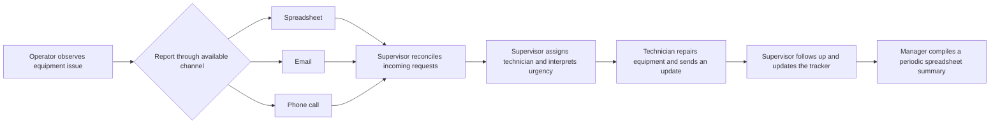
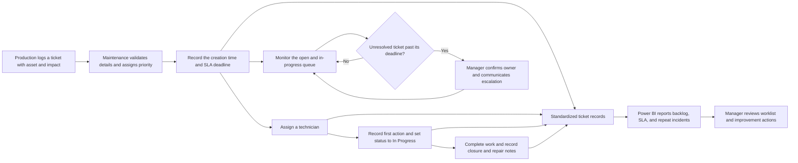

# Maintenance process flows

These workflows describe a fictional factory. The AS-IS map shows the scenario's manual process. The TO-BE map proposes changes for a future operating process. The portfolio demonstrates the data and reporting steps with a fixed synthetic snapshot.

## AS-IS — Requests tracked across channels

Different channels can omit an asset ID, timestamp, or status update. Supervisors have to check several places to learn whether work was assigned, started, or closed. Managers have no shared definition of an SLA breach.

## TO-BE — Standard ticket workflow with SLA reporting

Proposed escalation requires a maintenance owner and a communication step. In the portfolio, PostgreSQL holds the standardized records, and Power BI reads them for reporting. In a deployment, a ticketing system would capture and update those records.

[Business requirements](business_requirements.md) · [Rules and SLA thresholds](business_rules.md)
